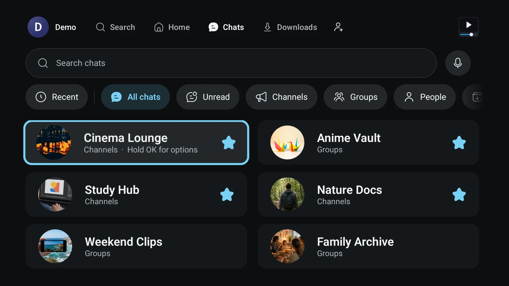
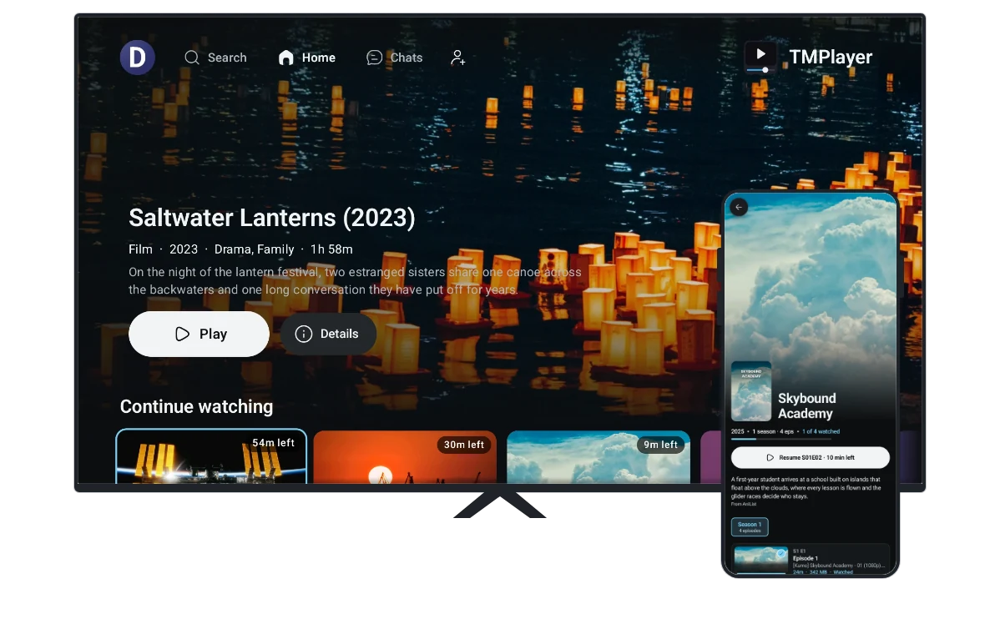
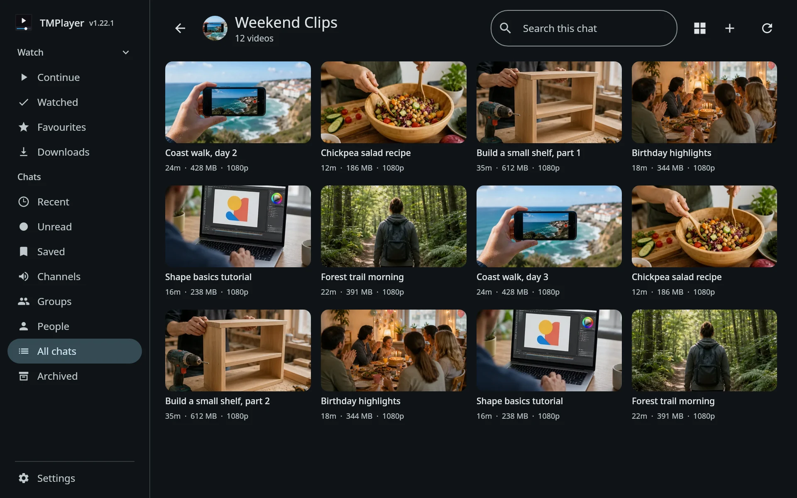
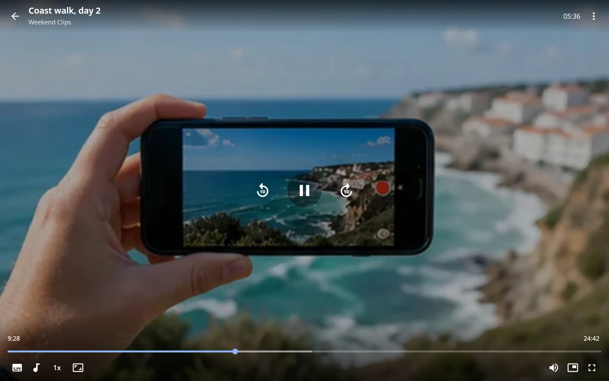

<p align="center">
  
</p>

<h1 align="center">TMPlayer</h1>

<p align="center">Your Telegram videos, on the TV, in your hand and on your computer. Start watching before the download finishes.</p>

<p align="center"><sub>TMPlayer is a free, open source, unofficial Telegram media player that plays the videos in your own Telegram chats on Android TV, Fire TV, Android phones, Windows, macOS and Linux, while they are still downloading.</sub></p>

<p align="center">
  
  
  
  
</p>

<p align="center">
  <a href="https://t.me/tmplayerapp"></a>
  <a href="https://github.com/dracu-lah/TMPlayer/discussions"></a>
  <a href="https://github.com/sponsors/dracu-lah"></a>
  <a href="https://buymeacoffee.com/nevil.dev"></a>
</p>

---

TMPlayer plays the videos in your own Telegram chats and channels on an Android TV, a phone, or a
Windows, Mac or Linux computer. It starts within seconds while the file is still downloading, and
seeking re-aims the download instead of waiting for it.

Sign in by scanning a QR code with your phone, pick a chat, and only its playable videos appear.
No messages, no server, no account except yours.

<p align="center">
  
</p>

<p align="center">
  
</p>

<p align="center">
  
  
</p>

## Runs on

- **Android 6.0 and up**, TV and phone from the same APK. It was built and tested on an 8 GB TV
  stick with a gigabyte of RAM, so a cheap device is the target.
- **Windows 10 and 11**, 64-bit, as an MSI installer.
- **Linux**, 64-bit x86 with glibc 2.35 or newer, as an AppImage, with an Arch PKGBUILD in
  [desktop/packaging/aur](desktop/packaging/aur).
- **macOS 26 Tahoe or newer** on Apple Silicon (M1 and later), as a DMG. It is not notarized by
  Apple yet, and Intel Macs are not supported.

Everything is on the same [GitHub release](../../releases), and
[tmplayer.org/download](https://tmplayer.org/download/) lists it by platform.

## Install

### Android TV and Google TV

With just the remote: install the free **Downloader** app from the Play Store, type
`tmplayer.org/apk` into it, press **Go**, and allow the install when the TV asks. On a Fire TV,
follow the [Fire TV guide](https://tmplayer.org/fire-tv/). A phone with Send files to TV, or `adb`
from a computer, work too; [INSTALL.md](INSTALL.md#other-ways-onto-a-tv) has both.

### Android phones

Open [tmplayer.org/download](https://tmplayer.org/download/) on the phone, download the APK, open
it and allow the install. [Obtainium](https://github.com/ImranR98/Obtainium) can also install it
straight from the releases and keep it up to date:

<a href="https://apps.obtainium.imranr.dev/redirect?r=obtainium://add/https://github.com/dracu-lah/TMPlayer"></a>

### Windows

Open **PowerShell** and paste:

```powershell
irm https://tmplayer.org/install.ps1 | iex
```

It downloads the MSI from the release, checks it against the published SHA-256 and installs it for
your user, with no SmartScreen warning. Prefer an installer? Download
`TMPlayer-<version>-windows-x64.msi` and open it. It is not code signed yet, so SmartScreen says
*Windows protected your PC*: click **More info**, then **Run anyway**.

### macOS

Download `TMPlayer-<version>-macos-arm64.dmg`, open it and drag **TMPlayer** onto
**Applications**. It is not notarized by Apple yet, so the first launch says *"TMPlayer" Not
Opened*: click **Done**, then **Open Anyway** in **System Settings**, **Privacy and Security**.
[INSTALL.md](INSTALL.md#macos) has every step, and how updates work on a Mac.

### Linux

```bash
chmod +x TMPlayer-<version>-x86_64.AppImage
./TMPlayer-<version>-x86_64.AppImage
```

Arch: build the PKGBUILD in [desktop/packaging/aur](desktop/packaging/aur) (it is not on the AUR),
or use the AppImage. The deb, rpm, Flatpak and Windows portable zip are no longer published;
[INSTALL.md](INSTALL.md#moving-from-a-format-that-is-no-longer-published) says how to move over.

[INSTALL.md](INSTALL.md) has the full steps for every platform, how to put the app on the desktop,
in the app menu and on the taskbar, the remote, touch and keyboard references, and troubleshooting.

## Build it yourself

You need JDK 21, Android SDK platform 37, and your own free Telegram credentials from
[my.telegram.org](https://my.telegram.org) in `local.properties`:

```properties
sdk.dir=/path/to/Android/Sdk
TG_API_ID=1234567
TG_API_HASH=your_api_hash
```

[.env.example](.env.example) lists every optional value the build reads, what each one turns on,
and how to set the same ones as repository secrets. All of them are optional: with none of them
present the app builds, runs and carries none of this project's own endpoints, which is what a
fork and every CI run get.

```bash
./gradlew test
./gradlew assembleDebug        # the Android app
./gradlew :desktop:run         # the desktop app, on the computer you are at
```

[docs/BUILDING.md](docs/BUILDING.md) covers release builds, the desktop app and its installers,
the reference test devices, and the version pins that are not free choices.

## Read more

- [Feature list](docs/FEATURES.md): everything the app does, and what it deliberately does not.
- [Changelog](https://tmplayer.org/changelog/): every release, with an RSS feed.
- [Install guide](INSTALL.md): sideloading, Windows, macOS and Linux, shortcuts, the remote and the keyboard, troubleshooting.
- [Architecture](docs/ARCHITECTURE.md): TDLib, the streaming `DataSource`, why it is built this way.
- [Building](docs/BUILDING.md) and [releasing](docs/RELEASING.md).
- [Contributing](CONTRIBUTING.md): ground rules, style, how to report an issue.
- [Third-party notices](THIRD_PARTY_NOTICES.md): dependency licences and source locations.

## Community and support

- **News:** the [Telegram channel](https://t.me/tmplayerapp) announces every release.
- **Help and chat:** the [Telegram group](https://t.me/tmplayer_chat) or
  [GitHub Discussions](https://github.com/dracu-lah/TMPlayer/discussions). Bugs go in
  [Issues](https://github.com/dracu-lah/TMPlayer/issues); security reports follow [SECURITY.md](SECURITY.md).
- **Chip in:** TMPlayer has no ads of our own (Telegram's sponsored messages appear in public channels, as Telegram requires) and no paid tier. If it helps you,
  [sponsor it on GitHub](https://github.com/sponsors/dracu-lah) or
  [buy me a coffee](https://buymeacoffee.com/nevil.dev). Either way, a star helps the next person trust it.
- **Email:** [hello@tmplayer.org](mailto:hello@tmplayer.org).

## Legal

Unofficial client. Not affiliated with, endorsed by, or connected to Telegram FZ-LLC. It uses the
official Telegram API through TDLib with your own Telegram account, as
[permitted for third-party clients](https://core.telegram.org/api/obtaining_api_id).

TMPlayer does not provide media, recommend channels, or bypass access controls. Use it only with
content you own or are authorized to access. See the website's [Privacy](https://tmplayer.org/privacy/)
and [Lawful use](https://tmplayer.org/legal/) pages.

## License

[GNU GPL-3.0-or-later](LICENSE) © 2026 dracu-lah, with an [additional permission for OpenSSL](LICENSE-OPENSSL-EXCEPTION.md)
(the Android app's TDLib links OpenSSL 1.1.1w). Bundled libraries and their sources:
[THIRD_PARTY_NOTICES.md](THIRD_PARTY_NOTICES.md).

Player mark via [SVG Repo](https://www.svgrepo.com), recoloured.
