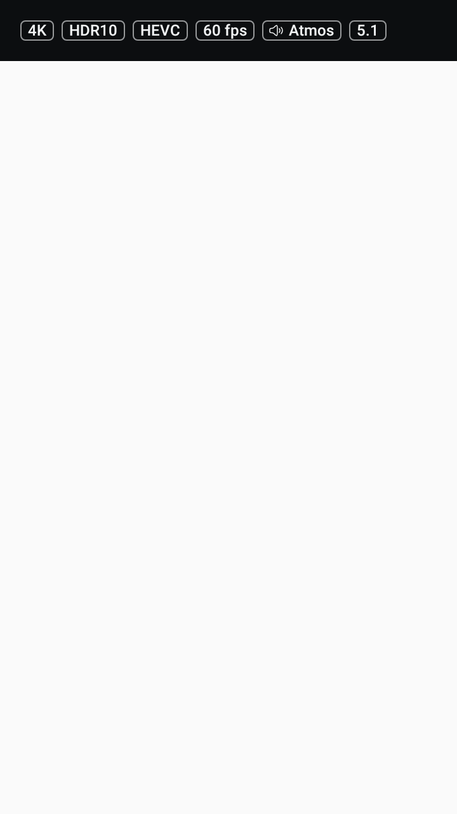
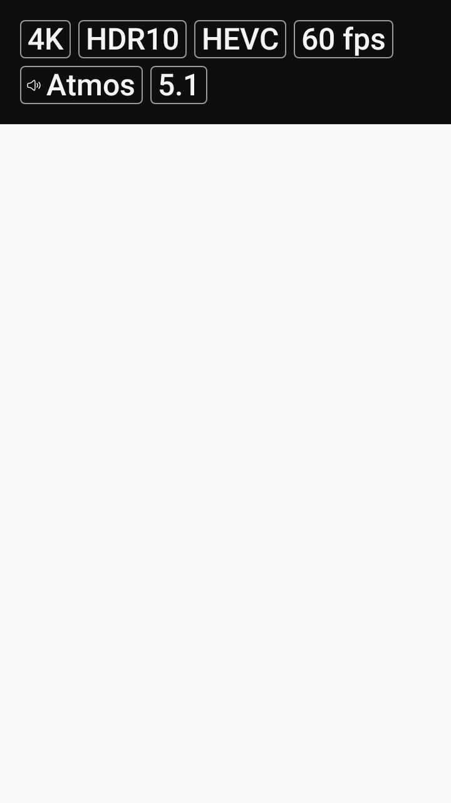
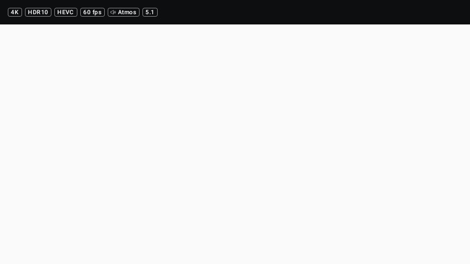
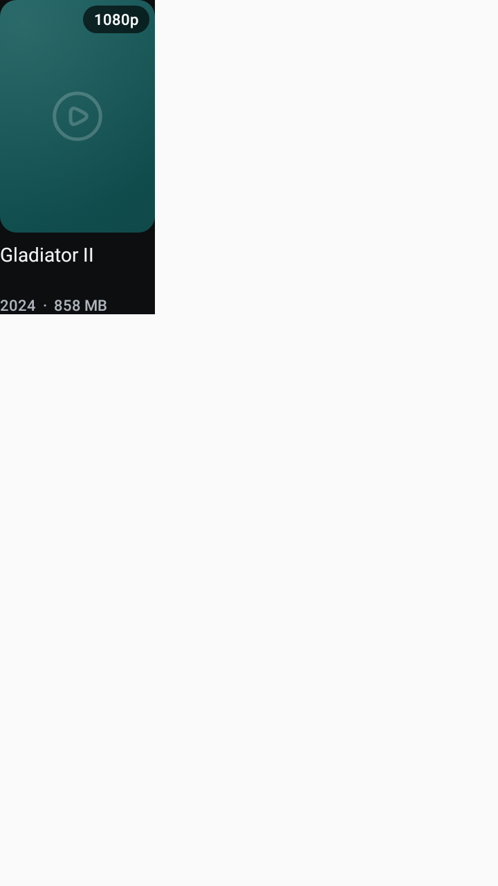
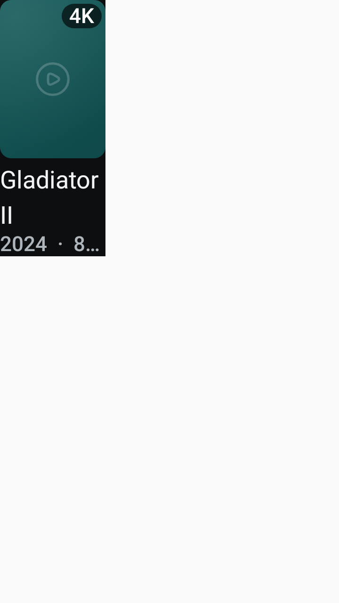
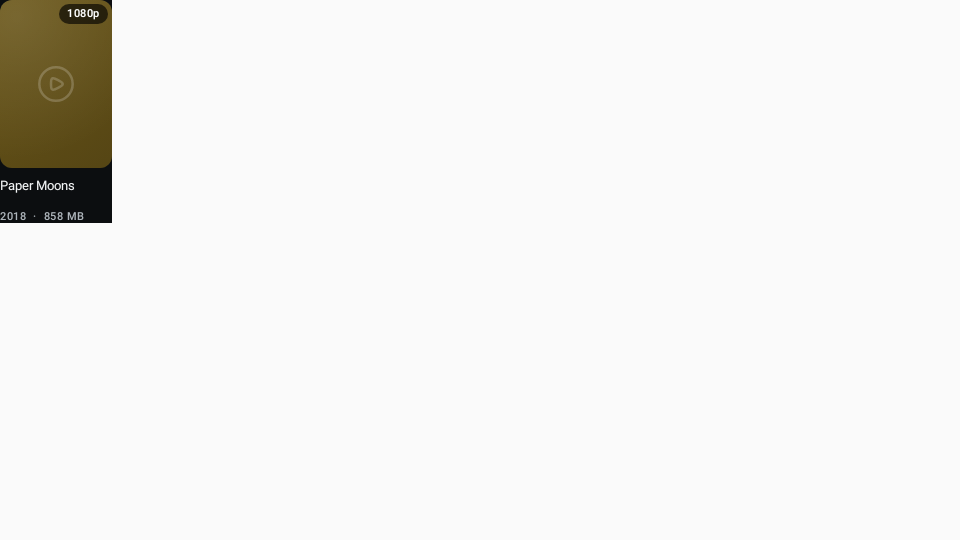
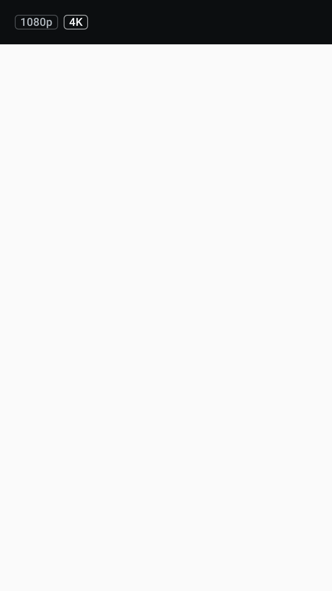

# Format badges (T8)

User, 2026-11-16: "HD, 4K, 1080p icons / logo images might be missing, add them if possible, also Dolby
Atmos and other stuff." Raju's problem: he cannot tell a 720p copy from a 4K one before pressing Play, and
cannot tell why a file looks dark (HDR on a screen that is not) or sounds thin (stereo vs 5.1). Today only
the details page shows one outlined "1080p" chip, read from the name; tiles show a name based quality chip
on posters (also "SD"), nothing else shows any format at all.

## What changes

One shared part, then four places.

- `FormatFacts` (core, pure, `com.tmplayer.data`): turns a picture size into a resolution class and a
  probe (what the player saw) into a list of plain tags. No Compose, no TDLib, builds for the web too.
- `FormatProbes` (core): a bounded in-memory cache of probes per video id (256 entries, oldest out).
  Filled only by a player that already has the tracks (after the first frame), never read from TDLib.
- `FormatBadge` (ui/shared, `components/FormatBadge.kt`): one text pill. Two looks: on art (the tile's
  black 64% plate, same as `TileBadge`) and on the page (the outlined chip the facts line used). Not a
  control: no focus stop, no click, no ripple; it only has text (read aloud as the text).
- `FormatBadgeRow` (same file): the pills of one video, wrapping, for the details page and Downloads.

### Our own pills, no logos

"Dolby", "Dolby Vision", "Dolby Atmos", "DTS", "HDR10+" and "4K Ultra HD" are licensed marks. The pills
are plain text in TMPlayer's own shape; the only picture is a generic speaker icon on audio pills. No
brand logo file is added or bundled. If the user gets a licence later, `FormatBadge` takes an optional
`mark` slot, nothing else changes (no work until then).

## Facts and where each comes from

| Fact | Source | When known |
| --- | --- | --- |
| SD, 720p, 1080p, 1440p, 4K, 8K | width and height Telegram states on the message | every tile, no cost |
| same, no size on the message | resolution words in the name only, drawn hollow ("from the name") | tile, details |
| HDR10, HDR10+, HLG, Dolby Vision, 10-bit, HEVC, AV1, 50+ fps | the player's tracks (Media3 `Format` on phone and TV, mpv's track list on the desktop) | after the first play of that video, kept for the session |
| Atmos, DTS, DTS-HD, DTS:X, AAC, 7.1, 5.1, stereo | the audio track's MIME type, codecs string, profile text, channel count | after the first play; in the track picker, per track, whenever the picker is open (the tracks are listed then) |

Not guessed: Atmos, HDR and Dolby Vision are never read from a file name (the details table keeps its
older "read from the file name" lines with their note; the pills never repeat them). Unknown shows nothing.
No empty pill, no placeholder, no "Unknown".

### Resolution rules (table-tested)

Landscape: the class is the higher of the one the long side gives and the one the short side gives, so a
crop (1920x800 is 1080p, 3840x1600 is 4K, 1280x536 is 720p) and a 4:3 (1440x1080 is 1080p) both land right.
Portrait (a phone clip, or a size with a rotation): only the short side counts (1080x2400 is 1080p, not
1440p). A picture wider than 2.6 to 1 is judged by its short side too (a 3840x1080 strip is 1080p).

| Class | Pill | Long side from | Short side from |
| --- | --- | --- | --- |
| SD | SD | any smaller | any smaller |
| HD | 720p | 1200 | 700 |
| Full HD | 1080p | 1800 | 1060 |
| 1440p | 1440p | 2400 | 1400 |
| 4K | 4K | 3600 | 2100 |
| 8K | 8K | 7000 | 4200 |

Zero, negative, missing one side, or a side over 20,000: no class (null). Never throws.

## Where it shows (one in, one out)

| Place | What | Out (replaced) |
| --- | --- | --- |
| Poster tile (phone, TV, desktop, web) | one resolution pill, top end corner, 720p and up, only when known | the name based chip that also said "SD" |
| Details page (phone, TV, desktop, web) | a row under the facts line: resolution, HDR kind, codec, 50+ fps, audio | the one outlined quality chip in the facts line |
| Player track picker (phone, TV) | per audio track: Atmos or DTS kind, and 5.1 / 7.1 / Stereo, as one pill each, in the line's detail | the plain word "Dolby" / "DTS" in the track name |
| Desktop player's track list | the audio track's name says its kind and layout ("English (Atmos 5.1)", "(DTS-HD 7.1)") | the raw codec word where a kind has a name |
| Downloads rows | one slot: `FormatBadgeRow` with the resolution, plus the probe's tags when known | none |

Nothing on Home rows beyond the tile pill; list rows (non-poster tiles) keep the quality in the facts line
under the title as today, so a row is not crowded.

## Phone, TV, desktop, web

| | Phone | TV | Desktop | Web |
| --- | --- | --- | --- | --- |
| Tile pill | yes | yes (same pill on the tile; the tile keeps its focus ring, the pill is not a stop) | yes | not yet: the web's items carry no picture size (see Follow-ups) |
| Details row | yes, wraps to a second line | yes; the facts block already is the D-pad stop, the row is inside it | yes | already wears the outlined resolution badge from the rules; no probe pills (no codec facts in a browser) |
| Track picker | yes | yes (rows already focusable, pills are text inside the row) | mpv audio list shows the same words | not shown (the browser gives no codec facts) |
| Probe source | Media3 tracks | Media3 tracks | mpv track list | none: only the size based pill |

## Edge cases

- Empty: no size, no name words: no pill, no gap.
- Huge: 100,000 videos: the tile pill is read from two ints on the item; no probe, no cache lookup per
  tile. The cache only grows when a video is played (256 cap).
- Absurd or garbage sizes (0, negative, 40000x40000, NaN frame rates, empty or megabyte long codec strings):
  null, never an exception. `GarbageInputTest` has the line.
- Several copies of one film: each copy's pill is its own size; the tile shows the newest copy's.
- 200% font: the pill is one line, `heightIn(min = 20.dp)`, grows with the font, never wraps inside; the tile
  corner holds at most this one pill; the details row wraps pill by pill. Layout test measures the tile at 2.0.
- Name says 1080p, size says 720p: the size wins (it is what the file declares); the name only fills in
  when there is no size, and then the pill is hollow.
- A Dolby Vision file on a screen without Dolby Vision (the app plays its base layer): the pill follows
  what the track listing shows, so it may say HDR10 for such a file; Dolby Vision shows where the track still
  declares it. Honest about the track, not about the label on the box.
- HDR10+: the player gives no signal on Android, so the pill appears only where a source says so (none yet);
  the classifier and its table are ready.
- Atmos on TrueHD: Media3 does not say, so it is not shown; E-AC-3 JOC says so and is shown.
- Interrupted play: the probe is stored when the tracks first list; a failed play leaves what was known.

## Follow-ups (not in this pass)

- Web poster tile: `VideoItem` has no width or height, and the rules only run in the worker, so the pill needs
  `itemOf` to carry the size and a worker side `FormatFacts.tileTag` answer. Not done: the web build cannot be run here.
- A probe for a file on disk without playing it (MediaExtractor on Android, ffprobe on the desktop).
- Persisting probes across restarts, and a Dolby Vision profile on Android before the base layer relabelling.

## After

Rendered by `FormatBadgeRenderTest` (phone, the same at a 2.0 font, television) into `format-badges/`:

| | |
| --- | --- |
| Details row, phone |  |
| Details row, phone, 200% font (wraps whole pills) |  |
| Details row, television |  |
| Poster tile, phone |  |
| Poster tile, phone, 200% font |  |
| Poster tile, television |  |
| A pill read from the name (hollow) |  |

Before: a poster wore a name based chip (also "SD"), the details page one outlined quality chip, nothing else
showed a format. No before picture is stored: it is the same tile without the corner pill.

## Raju check

A pill is a word he already knows ("4K", "1080p", "HDR10", "Dolby Vision", "Atmos", "5.1", "Stereo"), it
asks him for nothing, and it is absent when the app does not know. No setting, no switch, no new screen.
Gate answers: 1 yes (nothing to read), 2 decides itself, 3 appears when relevant (only when known), 4 extends
the facts line and the tile's corner (no parallel chip), 5 the tile loses "SD" on posters (a quiet change,
no card), 6 plain words (no codec jargon in the lead pill beyond HEVC/AV1, which only show on the details
row), 7 parity as above, 8 nothing destructive.

## Decisions made by Claude

- 2K is labelled "1440p" (the brief says 2K; "2K" also names the 1080p cinema format, and the app's copy
  names already use "720p", "1080p").
- No persistence of probes: a restart forgets them (the size based pill never needs them).
- Name based resolution is drawn hollow, not marked with a word, so no new string.
