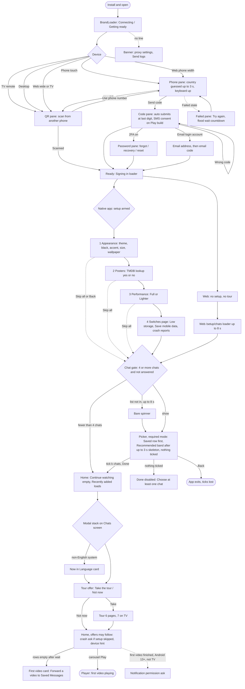
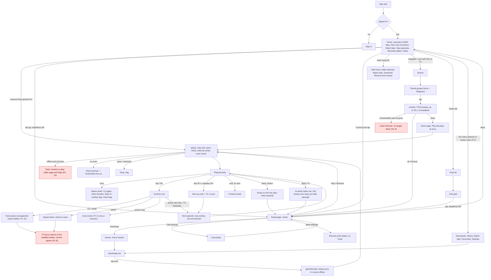

# UX and code review of all flows, 2026-11-15

Two code-trace reviews (no device run, step counts are estimates from the code). Sits beside
UX-REVIEW-2026-10-27.md (screens, wording) and REUSE-MAP-2026-11-15.md (what exists elsewhere).
Part 1: first run to first video and adding chats (ON-1 to ON-20). Part 2: browsing and playing
(PL-1 to PL-24). Fix plan: UX-ONBOARDING-FIXES-PLAN.md. Mermaid charts render in GitHub and VS Code.

---

# Part 1: onboarding and add chats

# TMPlayer onboarding review: first run to first video, and adding chats

Date 2026-11-15, read-only code trace (no device run). Builds on `private/UX-REVIEW-2026-10-27.md`
(not repeated: web sign-in QR-first on a narrow screen, TV sign-in sizes, QR refresh wording).
Paths are relative to the repo root. "Verify" marks a finding read from code that I could not run.

Recorded user decisions respected, not reopened: no Select all in the native pickers (2026-11-03);
Recommended chats are shown, never ticked (2026-11-04, commit 6d2e3df); the chat choice is mandatory.

## (a) Current flow

Dead ends: Back in the gate (exit, ticks lost, ON-5), a gate with no video chats (ON-4), the stale
gate model after a sign out and in on Android (ON-1), the First video card after chats were chosen (ON-15).

## (b) Step counts, install to first video playing

Counts are taps, clicks or D-pad presses on the device itself. Typing is listed apart.
R = required, O = optional or skippable. Best case: new account with 4 or more chats, English
system language, build with a crash DSN, Posters step present, 1 chat chosen, no 2FA.

### Phone (Android)

| # | Step | Taps | R/O |
| --- | --- | --- | --- |
| 1 | Open app, "Getting ready" loader, country guessed (fields locked up to 3 s) | 0 | R |
| 2 | Type number (about 10 digits, keyboard auto up) then Send code | 1 | R |
| 2b | Play build: system SMS consent prompt | 1 | O |
| 3 | Code: typed or autofilled, auto submits at last digit | 0 | R |
| 3b | 2FA password then Sign in | 1 | only with 2FA |
| 4 | Setup 1 Appearance, Next | 1 | O |
| 5 | Setup 2 Posters, Next | 1 | O |
| 6 | Setup 3 Performance, Next | 1 | O |
| 7 | Setup 4 Storage, mobile data, crash reports, Done | 1 | O |
| 8 | Gate: wait spinner if list not in (0 to 8 s), skeleton 0 to 3 s, scroll past Saved row, tick 1 chat, Done | 2 | R |
| 9 | Home: tour offer modal, Not now | 1 | O but blocks until pressed |
| 9b | Non-English only: "Now in X" card first | 1 | O |
| 10 | Home: carousel Play | 1 | R |

Total: 9 required-or-modal taps on the default path (Send code, 4 setup, 2 gate, tour, Play = 9), 10
with a non-English language, plus 2FA and SMS consent where they apply. Using Skip all on step 4: 6
taps (Send code, Skip all, tick, Done, Not now, Play). Notification permission is not asked until the
first video finishes (good). No storage permission is asked.

### Android TV (D-pad)

| # | Step | Presses | R/O |
| --- | --- | --- | --- |
| 1 | QR pane opens, focus on "Use phone number". Other device: Telegram, Settings, Devices, Link Desktop Device, scan (about 5 taps there) | 0 on TV | R |
| 1b | Alternative: Use phone number, type number with D-pad keyboard, then code, about 30 or more presses | many | alt |
| 2 | Setup 4 pages, focus starts on Next each time | 4 (Skip all: Up, OK = 2) | O |
| 3 | Gate: focus on the Saved row, Down to first Recommended row, OK tick, Right to Done, OK | 4 | R |
| 4 | Tour offer: Back (Down plus OK on "Not now" is 2) | 1 | O but blocks |
| 5 | Home: Play on hero (focus assumed on Play, verify on device) | 1 | R |

Total about 10 presses (8 with Skip all). Each extra chosen chat costs Down plus OK (2 presses).

### Desktop (Windows, Linux, macOS)

| # | Step | Clicks | R/O |
| --- | --- | --- | --- |
| 1 | Open, QR pane: scan from phone (about 5 taps there), or "Use phone number" click, type number, Send code, code | 0 or 3 | R |
| 2 | Setup 4 pages (Next, Next, Next, Done) | 4 | O |
| 3 | Gate overlay: tick 1 chat, Done | 2 | R |
| 4 | Tour offer modal | 1 | O |
| 5 | Home hover, Play | 1 | R |

Total 8 clicks on the QR path, 11 on the number path.

### Web app (Solid)

| # | Step | Clicks | R/O |
| --- | --- | --- | --- |
| 1 | Sign in: QR on wide screens, number on phone width. No setup, no tour, no crash question | 0 to 3 | R |
| 2 | `/setup/chats` loader (up to 8 s), then the picker: tick 1, Done | 2 | R |
| 3 | Home, Play | 1 | R |

Total 3 clicks on the QR path (plus Firefox's persistent storage prompt, ON-14). Shortest of the four.

### Add one more chat later

| Platform | Steps | Count |
| --- | --- | --- |
| Phone | PersonAdd button on Home or Chats top bar, picker opens (Recommended skeleton up to 3 s, ON-12), tap search and type, tick, Done | 4 taps plus typing |
| TV | Up to the top bar, Right to PersonAdd, OK; in the picker Left to the rail, Search, keyboard, Down, OK, Right, OK | about 10 to 14 presses plus typing |
| Desktop | Top bar PersonAdd, click search, type, tick, Done | 4 clicks |
| Web | Nav, Settings, Library page, "Choose chats", search, tick, Done (no top bar button, ON-13) | about 6 to 7 clicks |

### Add 20 chats

| Platform | Steps | Count |
| --- | --- | --- |
| Phone | 1 open, 20 ticks (scrolling or searching between), Done | 22 taps minimum |
| TV | open about 4, 20 times (Down, OK), Right, OK; held Down jumps help | about 45 presses |
| Desktop | 1 open, 20 ticks, Done | 22 clicks |
| Web | Select all or Ctrl+A exists but only over the rows shown (a scope or search), so 20 handpicked chats still cost about 20 clicks | about 22 |
| With ON-3 (Add these N) | open, one press, Done | 3 taps, 6 to 8 TV presses |

## (c) Findings

Type: ux or bug. Value H/M/L, cost S/M/L. "Steps saved" per run, on the path in (b).

| id | platform | what happens | file:line | fix | steps saved | value | cost | type |
| --- | --- | --- | --- | --- | --- | --- | --- | --- |
| ON-1 | Android phone, TV | The gate's picker model lives in the activity's ViewModelStore under the fixed key `add-chats--1`. After Sign out and a second sign in in the same process (the activity is not recreated: `onLoggedOut` only sets `screen`), the gate reuses that model: `saved` is still true, so `done()` returns at once (`saving \|\| saved`) and `LaunchedEffect(state.saved)` calls the empty `onClose`. Done does nothing, the old account's ticks show, no Recommended band (taken once). Only Back (exits the app) gets out. Verify with sign out then sign in without killing the app | `MainActivity.kt:178` (GATE_RUN), `:1792-1800`; `AddChatsPage.kt:54`; `AddChatsViewModel.kt:291`, `:240-241` | Key the gate model by a sign-in epoch (a counter bumped when `setupPending` arms), or call a `reset()` on the model when the gate appears. Desktop is fine (`rememberViewModel(Unit)` inside the overlay, `Shell.kt:622`) | unblocks a trap | H | S | bug |
| ON-2 | all | The gate says "The ones with the most videos are already ticked" but nothing is ticked since 6d2e3df. The viewer reads a promise the screen breaks, and may press Done believing the right chats are in (Done is disabled, so they hit "Choose at least one chat"). Stale comments say the same (web header, VM KDoc, `startOnDone` can never be true on a first run) | `core/.../en.json:1758` (`picker.gate_body`); `AddChats.tsx:7-8`; `AddChatsViewModel.kt:97-101`; `AddChatsScreen.kt:432`; `ChatSuggestions.kt:28` (MAX_PRETICKED, `ticked` unused) | Reword: "The chats with the most videos are listed first under Recommended. Tick the ones you want." Translate for the 21 catalogs before release. Remove the dead pre-tick code | 0, removes a contradiction | H | S | bug (copy) |
| ON-3 | phone, TV, desktop (web has Select all) | No bulk path in the native pickers: 20 chats are 20 ticks, on a TV 40 presses. The Recommended band can hold dozens of chats (every chat with 20 or more videos in the 60 newest) and there is no way to take them together | `AddChatsScreen.kt:690-720` (band loop), `ChatSuggestions.kt:56-69` | One button in the Recommended band header: "Add these N chats". It is an explicit act, so it keeps "nothing ticked for the viewer". On TV it is one row the remote reaches by Down. Optionally long press range select | N-1 taps (phone, desktop), 2(N-1) presses (TV); gate with 8 recommended: 7 taps | H | S | ux |
| ON-4 | all | The gate fires at 4 chats of any kind (bots, the Telegram service chat, people count), and it cannot be passed without ticking one. An account whose chats hold no videos gets "Choose at least one chat" with nothing sensible to tick, and Back leaves the app. The web waives a list that is too short or fails to load; native only waives under 4 chats | `ChatsGate.kt:25` (MIN_CHATS), `:68-71`; `AddChatsScreen.kt:303`, `:1025` (DisabledDone) | When the head start finished and `recommended` is empty, offer "Continue with Saved Messages only" (writes a Picked answer of Saved Messages, or waives for this visit as web `setChatsGateWaived` does). Count only chats that are channels, groups or have media for MIN_CHATS | 0, removes a dead end | M | S | ux |
| ON-5 | Android phone, TV | In the required gate, system Back calls `finish()` at once. Ticks live only in the model, so 10 careful ticks vanish on a stray Back or gesture. The comment says a discard question is skipped on purpose, but an exit with ticks is the worst case. On TV the first Back climbs to the rail, the second exits | `AddChatsScreen.kt:476` (`required -> onLeave()`), `MainActivity.kt:1796-1797` | With ticks present, Back asks "Leave TMPlayer? Your picks are not saved" (reuse `Ask.Discard` shape) or uses the two-press toast the sign-in already has (`ExitOnBack`, `LoginScreen.kt:279`) | prevents loss of up to N ticks | M | S | ux |
| ON-6 | Android, desktop | The gate's 8 s wait timer is `LaunchedEffect(Unit)` in `rememberChatsGate`, which the shell calls at the top of the main composable (before the sign-in branch). It starts at app launch, so after a first sign in plus setup (minutes) `waitedOut` is already true and `Move.Wait` is never used. If the chat list is slow, Home shows every chat unfiltered (Unanswered means all) and the picker pops in over it when the list lands | `ChatsGateHost.kt:48-51`; `MainActivity.kt:797`; `Shell.kt:333` | Key the timer on the moment the gate can first show: `LaunchedEffect(setupPending)` restarting when it turns false, or only when `auth is Ready` | avoids a flash of an unfiltered Home | M | S | bug |
| ON-7 | phone, TV, desktop | The wait state is a bare spinner for up to 8 s: no words, no way out. The string "Loading your chats" exists (`picker.loading`) | `MainActivity.kt:1786-1789`; `Shell.kt:614-617` | Show `picker.loading` under the spinner and, after 4 s, a "Continue without choosing" quiet button (ties to ON-4) | 0 | L | S | ux |
| ON-8 | phone, TV, desktop | Four preference pages are asked before any value, each with a recommended default that nearly everyone keeps: Posters, Performance, then Storage, Mobile data and Crash reports. `DeviceFit` already detects slow devices (Device step) yet Performance is added on every device. Crash consent already has a later home (`CrashAskHost` after the first value) | `Setup.kt:143-147` (steps), `:171-173`; `SetupScreen.kt:163-183`; `CrashAskCard.kt:105` | (1) Add Performance only when `DeviceFit` is not Fine (the Device step covers weak devices). (2) Make step 1's primary "Use recommended settings" (rename "Skip all", `en.json:2984`) so the common path is one press. (3) Move Posters, Storage, Mobile data into Settings with their defaults, and ask crash reports through the existing card after the first video. Keep Appearance as the only page | 3 taps or presses (4 pages to 1); 1 if only (1) | H | M | ux |
| ON-9 | phone, TV, desktop | Back on the first setup page (Appearance) is Skip all: a TV remote or a back gesture meant as "go back" silently ends the whole setup, crash question included, with no word | `AppearanceStep.kt:104` | Back on Appearance asks nothing but also should not skip: map it to the system default (leave the app on the phone, nothing on TV) or toast "Press Skip all to skip the setup" | 0 | L | S | ux |
| ON-10 | phone, TV, desktop (non-English) | `languageAnnounced` is empty on a fresh install, so on the first Home the card "Now in Español" appears, after the whole setup already ran in that language. It sits ahead of the tour offer in the modal stack | `LanguageSetting.kt:64-66`; `LanguageNotice.shouldShow` (`announced` blank); `MainActivity.kt:2431-2434` | In `markSetupDone` (or when the setup arms) write `setLanguageAnnounced(active)` so only a later language change announces | 1 tap | M | S | ux |
| ON-11 | phone, TV, desktop | The tour offer is a modal over the first Home, the moment the user should see their videos. "Not now" calls `markTourDone`, so it is "never again" while labelled "not now". Together with the language card, crash card and device hint, the first Home can stack up to four cards before the first Play | `MainActivity.kt:2468-2480`, `:2536`; `Settings.markTourDone` (`SettingsStore.kt:2441`) | Show the offer as a quiet row card under the hero (or after the first finished video) rather than a modal. Label "Not now" truthfully: re-offer once after 7 days, or rename to "No thanks". Queue first-run cards so at most one shows per session | 1 tap | M | S | ux |
| ON-12 | phone, TV, desktop | Opening the picker later (add one more chat) repeats the first-run work: `start()` sets `recommending=true` on every opening, so the Recommended band is held by skeleton rows up to 3 s and then lands above everything. `ChatPicking.rows` does not exclude chats already added, so ticked chats show twice (Recommended and their band), and there is no "Added" band to see what is in | `AddChatsViewModel.kt:126`; `AddChatsScreen.kt:259`; `ChatPicking.kt:102` | When the stored mode is Picked: skip the hold, build Recommended from chats not yet added, and put an "Added (n)" band first (collapsible on TV). Opening to add one chat then needs no wait | up to 3 s of wait, 0 taps | M | S | ux |
| ON-13 | web | No add-chats button on Home or Chats (native: PersonAdd in the top bar, `ChooseChatsButton`). The only ways in are Settings > Library, and the two empty states, so adding one chat later is 6 to 7 clicks versus 4 | `webapp/src/screens/Chats.tsx:107-112`, `Home.tsx:119`, `Settings.tsx:416`, `:794` | Add an "Add chats" icon button to `PageBar` on Home and Chats (same `/added-chats`, `data-tv-first` on TV) | 2 to 3 clicks | M | S | ux |
| ON-14 | web | `askKeepOnce()` runs as soon as the user is signed in, so on Firefox the "store data persistently" prompt appears over the setup loader and the gate, before any value, and it is spent after one answer | `App.tsx:112-116`; `install.ts:100-107` | Ask at the first download or the first Watch, or when the user installs the app | 1 prompt | L | S | ux |
| ON-15 | phone, TV, desktop | With rows empty after the wait (offline, size filter hides all, chosen chats hold no video yet), Home says "Get your first video in: Forward any video to Saved Messages", and the chat list tip says the same, although the user just chose chats. The text contradicts the gate they passed | `HomePane.kt:238`, `desktop/.../Home.kt:322-335`, `FirstRun.kt:60-80`, `BrowseScreen.kt:842` | When the stored mode is Picked: title "Nothing to show from your chosen chats yet", body naming the size filter and "Choose more chats", button Choose chats (`HomeNoneChosenCard` text already exists). Keep the forward tip for the unanswered case | 0 | M | S | ux |
| ON-16 | Android, desktop | `SetupScreen.next()` applies the answer in `rememberCoroutineScope()` and calls `onDone()` in the same press. On the last page `onDone` flips `setupPending`, the screen leaves composition and its scope is cancelled. Multi-write answers (Full quality and Lighter write 3 settings one after another; crash consent writes then starts the SDK) can be cut between writes. Writes are serialized by DataStore, so the first lands, later ones may not. Verify with Lighter on the last page | `SetupScreen.kt:163-183` (`:171`), `MainActivity.kt:1727`, `Shell.kt:562` | Make `onDone` suspend and await the apply (`applyTo`) before `markSetupDone`, or launch the apply in `App.backgroundScope` | 0 | M | S | bug (risk) |
| ON-17 | Android phone | The Back handler on the QR pane (touch) goes to the phone pane, and Back on the phone pane needs two presses to leave. Fine. But the proxy and Send logs entry is a MoreVert icon hidden whenever the keyboard is up, i.e. on the phone pane while typing, exactly where a blocked network fails (no code arrives). The banner covers only "no line" | `MainActivity.kt:1611` (`if (!keyboard)`), `LoginScreen.kt:305-` | When Send code stays busy for 8 s or the Failed pane shows, put "Proxy settings" in the pane (a quiet link under Send code) | 0 | L | S | ux |
| ON-18 | phone, TV, desktop | `AddChatsViewModel.open()` replaces `ticked` with the stored ids when the read lands. Ticks made in the first moments (fast thumb on a warm store) are overwritten | `AddChatsViewModel.kt:111` | `ticked + ids` (union) when nothing was opened yet | 0 | L | S | bug |
| ON-19 | all | Dead strings translated in 21 catalogs: `setup.chats_*`, `setup.library_*`, `picker.add_later`, `picker.add_more`, `picker.add_more_detail`, `picker.added_count`, `picker.all_chats` have no reader (grep in app, ui, desktop, webapp finds none; confirm with the catalog test) | `en.json:1731-1736`, `:2925-2930`, `:2957-2962` | Remove, or use `picker.add_more` as the tooltip/label for the new Add chats button and `picker.added_count` in the Home none-added card | 0 | L | S | ux (hygiene) |
| ON-20 | TV | The setup has no skip ladder explained on TV: Skip all is a quiet button at the top, reached by Up from Next (focus starts on Next). A remote user who does not press Up never learns the setup can be skipped, and the TV sees the 4 pages | `StepChrome.kt:139-141` | With ON-8 (primary "Use recommended settings" next to Next), the skip is one Right press from the start focus | 2 presses | M | S | ux |

Count: 20 findings (15 ux incl. 1 hygiene, 5 bug: 1 copy, 1 risk).

## What already works (kept out of the findings)

- Phone sign-in: country guessed, keyboard up, boxed code with auto submit, SMS consent, flood wait countdown, Failed pane with Try again, two press exit guard.
- Setup defaults are real (Next on an untouched page keeps everything), Skip all on every page, remote starts on Next.
- Notification permission is deferred to after the first finished video; nothing asks for storage.
- Web has no setup or tour, so it is the shortest path.
- Chat count rows are lazy, counted only when on screen, and the head start is bounded (60 chats, 3 s).
- Error rules: no `!!`, `.first()` or `[0]` on outside data found on these paths (the hits are on own enums, own saved state, and guarded smart casts).

## Tips for the plan

- Order by value for cost: ON-1 and ON-2 (trap and false promise), ON-3 and ON-8 (steps), ON-6, ON-10, ON-12.
- ON-3 plus ON-8 take the phone path from 9 to about 5 taps and the TV from 10 to about 5 presses.
- A test for ON-1: a Compose test that shows the gate, presses Done, signs out, shows the gate again and presses Done.

---

# Part 2: browsing and playing

# TMPlayer review: browsing and playing (2026-11-15)

Read-only review by code reading (no device, no gradle). Base: `main` at `0b8afa2`.
`private/UX-REVIEW-2026-10-27.md` was read first; nothing from it is repeated. Where one of its
open items blocks step reduction it is cited as "UXR-n" (n = its "Do next" number).

Defaults assumed for step counts: "Open a video's page first" ON (`SettingsStore.kt:628`, default
true), autoplay ON (`PlayerActivity.kt:6346` default true), mini player ON (`SettingsStore.kt:1140`),
Home loaded, online, a started video exists. Typing is not counted. Counts are from code, not timed
on a device. TV, phone and desktop are separate columns; the Solid web app is noted at the end.

## (a) Current browse-to-play flow

## (b) Step counts from app start (Home loaded)

Phone = taps, TV = D-pad presses, Desktop = clicks or keys. "Now" is the shortest path the code
allows with defaults. "Min" is the best reachable with the fix named.

| # | Task | Phone now | Phone min | TV now | TV min | Desktop now | Desktop min | How to reach min |
| --- | --- | --- | --- | --- | --- | --- | --- | --- |
| 1 | Resume last video | 3 (scroll to Continue row, tap card, tap Resume); 2 if row is on screen | 1 | 3 (Down to Continue row, OK card, OK Resume); TV focus starts on a NEW title's Play | 1 | 1 to 2 (hover Play on a Continue card, else card then Resume; carousel holds up to 2 resume pages) | 1 | PL-1 (resume as first carousel page and TV start focus), PL-2 (tile tap resumes) |
| 2 | Play a known video via search | 3 + typing (magnifier, result, Play) | 2 | about 6 + typing (Up, Left to Search, OK, Down to result, OK, OK Play); mic first on TV | 4 | 2 keys + typing (Ctrl+K, Ctrl+Enter plays) | 2 | PL-6 (play action on a result, result with progress resumes), PL-5 (no 30 s wait) |
| 3 | Next episode | 0 (autoplay, 15 s count); 1 on the card; manual 2 (tap picture, tap next disc) | 0 | 0 (autoplay); 1 on card in last 30 s; manual about 7 (Down, Down, Right to Episodes, OK, pick, OK) unless remote has a Next key | 2 | 0 or one key | 0 | PL-11 (Next button in TV row), PL-12 (autoplay toggle honoured) |
| 4 | Pick other subtitle or audio | 3 (tap picture, CC or audio, track) | 2 | 5 (Down, Down, OK, Down, OK); audio +1 | 2 | 1 key (cycle) or 2 to 3 clicks | 1 | PL-9 (first Down lands on buttons), PL-10 (CC and audio keys), PL-22 |
| 5 | Switch speed | 3 (tap picture, speed, preset) | 2 | about 7 (Down, Down, Right, Right, OK, pick, OK); focus then drops to Subtitles | 4 | 1 key | 1 | PL-9, PL-8, PL-21 |
| 6 | Save for offline, then play | save 2 (tile, Download), play later 3 (You, Downloads, card) = 5 | 3 | save about 5 (OK tile, Right to Download, OK), later about 6 (Up to avatar, OK, Down, OK, OK) = 11 | 5 | save 2, later 3 = 5 | 3 | PL-13 (Downloaded row on Home, offline pill opens Downloads), PL-16 |
| 7 | Cast to a TV | 4 (tile, Cast, device, Play); from the player 3 on top of Play | 2 | n/a (the TV is the receiver; `PlayerActivity.kt:2058` skips Cast on TV) | n/a | 2 to 3 (player Cast, device) | 2 | PL-20 (Cast entry on Home; a connected session casts on Play, verify) |
| 8 | Mark watched / remove from Continue | 2 (hold tile, menu entry) | 1 with Undo | 3 (hold OK, Down, OK) | 2 | 2 (right click, entry) | 1 | PL-19 (Undo and a swipe or X on the card) |
| 9 | Player back to where you were | 1 (Back; lands on the page the video was opened from, a 2nd Back reaches Home) | 1 | 1 playing, 2 when paused (row up) | 1 | 1 (Esc or Back) | 1 | PL-18 (paused video should close, not dock) |

Notes on the table:
- Row 1 on desktop: `HomeFeatured.mix` (resume at slot 2 and 4) is desktop only (`desktop/src/main/kotlin/com/tmplayer/desktop/ui/Home.kt:267`); phone and TV call `HomeFeatured.pick` on Recently added alone (`HomePane.kt:1406`).
- Row 3 TV: `PlayerControls.kt:651-653` hides the previous and next discs on TV by design; only the media keys (`PlayerActivity.kt:6818`), the next-up card and the Episodes word button (`player_controls.xml:553`) are left. The Google TV and Mi remotes have no media-next key.
- Row 7: after one connection, `PlayerCast.onSession` (`PlayerCast.kt:249`) begins casting when a session is already Connected, so later Plays on the phone go straight to the TV (needs a device check).
- Row 9: the page stays open under the player (`MainActivity.kt:1373-1380` comment), so Back is cheap; it is the mini bar and the TV paused row that add presses.

## (c) Findings

Columns: type ux or bug; value H/M/L; cost S/M/L. File refs are exact lines at `0b8afa2`.

| id | platform | what happens | file:line | fix | steps saved | value | cost | type |
| --- | --- | --- | --- | --- | --- | --- | --- | --- |
| PL-1 | phone, TV | Resume is never the hero. Phone and TV carousels are built from Recently added only; desktop mixes resume pages in (`mix`). On TV the start focus is the carousel's Play of a new title, so a habitual OK starts something new, and the Continue row is a Down away | `ui/browse/HomePane.kt:1396-1432` (rememberFeatured), `core/.../HomeFeatured.kt:224` (mix, desktop only), `HomePane.kt:818-829` (TV start focus) | Use `HomeFeatured.mix` on phone and TV too, first page = the last started video when it is under about 2 weeks old and not finished, label "Resume ...". On TV start focus on the first Continue card when the row exists and the hero is new content. Keeps UXR-2's resume-store fix as a prerequisite | phone 3 to 1, TV 3 to 1 | H | M | ux |
| PL-2 | all | A Continue watching tile tap opens the page first, then Resume: two actions for a resume intent. Rule was set 2026-10-23 so Continue and Watched answer the same press | `ui/browse/BrowseScreen.kt:395-413` | Decision for the user: a Continue tile that has a resume point plays at once (Netflix, Prime, Plex do); hold or Info opens the page; Watched list keeps opening the page. A "Resume" tick on the tile makes it predictable | 1 on every platform | H | S | ux |
| PL-3 | desktop | Home drops every Continue and Watch later card whose video has no Telegram thumbnail (`hasArt`), so an in-progress video is missing from Home. Phone and TV show it with the generated cover | `core/.../HomeRows.kt:525-540` (withArt), `desktop/.../ui/Home.kt:273` | Keep the card once its art lookup has settled and draw the generated cover (UXR-8 frame grab later); drop it only when the video is Gone | makes a video reachable in 1 instead of via History (3 or more) | H | S | bug |
| PL-4 | all | Search `stillThere` is `mediaItem(...) != null`; `mediaItem` is null for `MessageLookup.Unreachable` (flood wait, 5xx, timer or withheld post, `lookupMedia` heldBack). `check` then removes the result group and says "no longer there" for a video that is fine. The KDoc says null must open it | `ui/.../GlobalSearchViewModel.kt:84-87`, `:342-353`; `core/.../ChatRepository.kt:533-534, 544-560` | Use `lookupMedia`: Gone to false, Found to true, Unreachable to null | avoids a lost result and a re-search (about 4) | M | S | bug |
| PL-5 | phone, TV, desktop | A search result tap does nothing visible until `check` returns: `awaitConnectedSessionOrNull()` waits up to 30 s when Telegram is connecting or offline, and a downloaded result offline hits the same wait. No pressed state, no spinner | `GlobalSearchViewModel.kt:84-87`; `core/.../Td.kt:1301, 1647`; callers `PhoneBrowse.kt:171-190`, `TvSearch.kt:641-654`, `desktop/.../SearchPalette.kt:276-282` | Skip `check` for items on device or when offline; otherwise cap at 2 s and open anyway; or open now and verify in the background (page already handles Gone). Show the Starting pill (`PlayPress`) for the wait | up to 30 s of dead time | H | S | bug |
| PL-6 | phone, TV | Search results only open a page. Desktop has `play` (Ctrl+Enter); phone and TV rows show progress (`progress(it)`) but cannot resume or play | `desktop/.../SearchPalette.kt:266-290` vs `PhoneBrowse.kt:171-190`, `TvSearch.kt:641-654` | A Play or Resume button on a film result (phone), long OK on TV, and a one-episode show plays through its page already. Result with progress shows "Resume" | 1 | M | S | ux |
| PL-7 | TV | Search results have no `TileReturn`; the page opens in its own window over the list. Chat grids and Continue rows added it because focus fell to the first tile or the bar after Back (Mi TV, 2026-10-23). Not seen on a device here | `TvSearch.kt:625-678` (none) vs `BrowseScreen.kt:1567`, `TileReturn.kt:1-30` | Add `rememberTileReturn` and `returnTile` to result cards; test with `performKeyInput` | 2 to 5 presses after each Back | M | S | ux (verify) |
| PL-8 | TV | After any sheet or picker closes, `focusRow()` always focuses the Subtitles button, not the button that opened it. Speed 1.25 then 1.5 means Right, Right again; the audio picker lands on Subtitles | `PlayerActivity.kt:1944-1949` (sheets), `:2033` (track picker), `:7477`; `PlayerControls.kt:931-935` | Remember the last focused row button id before opening and restore it in `focusRow` | 2 per repeat | M | S | bug |
| PL-9 | TV | The first Down or Up over the bare picture raises the row with focus on the scrub bar; a second Down is needed to reach any button. Left and Right already seek without the row (`:6838`), so the bar focus buys nothing there | `PlayerControls.kt:905-907` (`timeBar.requestFocus()`), `:659`; `PlayerActivity.kt:6854-6880` | Down from the bare picture shows the row and focuses the first button (Subtitles); Up or OK keeps the bar | 1 on tasks 4 and 5, and on every More, Episodes and Shape press | H | S | ux |
| PL-10 | TV | No dedicated keys: CAPTIONS (175), MEDIA_AUDIO_TRACK (222) and the speed keys are unhandled (only Info long press, Menu on Fire TV, Next and Previous are). Remotes of many TVs have a CC or Subtitle key | grep: no `KEYCODE_CAPTIONS` or `MEDIA_AUDIO_TRACK` in `player/`; `PlayerActivity.kt:6628-6880` | Map them to open the picker (or cycle), like the desktop's SubtitleNext and AudioNext | 5 to 2 for subtitles | M | S | ux |
| PL-11 | TV | The row has no Next episode button (hidden by design); manual skip needs the Episodes word button at the end of the row (about 7 presses) or a media-next key the Google TV and Mi remotes do not have. The next-up card helps only in the last 30 s and only with autoplay ON | `PlayerControls.kt:651-653`; `player_controls.xml:553`; `PlayerActivity.kt:3127-3134` | Add "Next episode" as a row button when `_episodes.next != null`; Up on the bare picture could jump to it | about 5 | H | S | ux |
| PL-12 | phone, TV | `watchForTheEnd` reads the autoplay setting once per STARTED period. The Episodes panel switch (`setAutoplayFromEpisodes`) changes `autoplayNext` and the store, not this loop. Switch OFF mid-episode: the next-up card and count still show and then nothing plays (`onVideoEnded` re-reads at `:6346`). Switch ON: no card, only the 15 s status count | `PlayerActivity.kt:8472-8476` (single read), `:8700-8705` (setter), `:6346` | Read `autoplayNext` each tick (it is already the live copy) and hide the card when it turns off | none, avoids a wrong promise | M | S | bug |
| PL-13 | phone, TV, desktop | Offline: Home keeps showing every card as playable. A tap opens the page, Play runs the whole `playNow` and ends in a toast "connect to play" (`mainConnectToPlay`). The Offline pill is passive text. Offline play needs You then Downloads then card (3), TV about 6 | `MainActivity.kt:1283-1290` (toast), `ui/components/ConnectionStatus.kt:42-103` (passive), no download cue on tiles (grep onDevice in `HomePane.kt`, `ContinueCard.kt`: none) | Offline: a "Downloaded" row on top of Home, a check or dim on tiles by local availability, the pill gets "Open Downloads". Same row online as a normal Home row (HomeRow type) | offline play 3 to 1; removes 2 wasted steps per failed try | H | M | ux |
| PL-14 | phone, TV | `openStoredNow` always waits for `Td.lookupMedia` (up to 6 s) before `play`, even when offline or the file is complete in the watch cache. Only Downloads-folder videos skip it. A Continue resume offline of a cached video stalls 6 s behind the Starting pill | `MainActivity.kt:1450-1470`; `Td.kt:1352-1362, 1650` (LOOKUP_TIMEOUT_MS 6000) | If `Td.localFileAvailability` is Complete or the network is Offline, `play(stored)` first; refresh the id in the background | up to 6 s | M | S | bug |
| PL-15 | phone, TV | Previous and next episode are found only by searching the chat on Telegram. Offline (or when the search fails) a downloaded season has no Next button and no autoplay; nothing falls back to the other downloaded episodes of the show that Downloads already groups | `PlayerActivity.kt:5758-5775` (findEpisodes), `core/.../EpisodeSteps.kt:117-139` (lookUp via fetch only) | When `mediaPage` fails or is empty, build `EpisodeSteps` from `LocalDownloads` and the watch cache for the same show key. TDLib may answer from its message cache offline, check on a device first | autoplay offline: manual 7 to 0 | H | M | bug |
| PL-16 | TV | Downloads, History, Watch later and Favourites live only in the avatar menu at the end of the top bar. From the player's Back focus returns to Home, so each visit is Up, Left, OK, Down, OK (about 5) | `ui/browse/TvTopBar.kt:104-117` | "Downloaded" and "Watch later" as Home rows (PL-13), and Chats-style quick entries in the bar for Downloads | 4 | M | S | ux |
| PL-17 | all | A search page that fails in `loadMore` just clears the spinner; the grid has `moreFailed` with Try again (`MediaGridScreen.kt:1023-1042`) but search has no such state. At the end of the list nothing asks again except scrolling up and down | `GlobalSearchViewModel.kt:312-316`; `PhoneSearch.kt:615`; `TvSearch.kt:351` | Add `moreFailed` to `GlobalSearchState` and a Try again row, as the grid does | 3 to 5 | L | S | ux |
| PL-18 | phone, desktop | Back from a paused video docks it to the mini bar (the verdict has no "paused" case), keeping the decoder, the session and the notification. Back on a paused video usually means done | `core/.../MiniPlayer.kt:90-100`; `PlayerActivity.kt:4812-4850` | Verdict `Paused`: close (and keep the resume point) when `playWhenReady` is false for more than a few seconds. Decision for the user | 1 (no X to stop) | L | S | ux |
| PL-19 | all | Mark as watched wipes the resume point and removes Continue watching with no Undo ("Not said"). A mis-tap on a hold menu loses a 1 h 40 position. UXR-9 covers wording only; Undo here is open | `MainActivity.kt:1420-1447` | Snackbar "Marked watched, Undo" restoring the point (keep the old `ResumeRecord` for 8 s). Applies to phone, desktop and TV (TV through a confirmation chip) | none, avoids a 3 to 5 step recovery | M | S | ux |
| PL-20 | phone | Cast only starts from the player or an opened page (`CastPageButton`), not from Home or the hero. Four steps from Home. Desktop has its own control, TV is receiver only | `MediaDetailSheet.kt:616-618`; `cast/CastPicker.kt:93-105`; `PlayerActivity.kt:2058` | Cast button on Home's phone header or the carousel (the session then casts on every Play, as `PlayerCast.onSession` allows). Verify it on a device | 2 | L | M | ux |
| PL-21 | phone, TV | The speed button is a bare icon with no current value, and a preset is the only way (3 taps). The hold-to-2x gesture is not announced beyond the first-run hint (the hint only lists double tap and the three swipes) | `PlayerControls.kt:262` (onPickSpeed); `core/.../FirstRunHint.kt:14-20` | Show "1.25x" on the button when not 1x; tap cycles the last two used speeds, long press opens the sheet; add hold-to-fast-forward to the first-run hint | 1 | L | S | ux |
| PL-22 | phone, TV | The track picker skips tracks the player cannot decode (`if (!group.isTrackSupported(index)) continue`). A file whose only subtitles are unsupported then says "No subtitles in this file" and offers online search; the viewer cannot tell the file has some | `TrackPickerFragment.kt:214` (options loop) and the `none` line below it | List them dimmed with "not supported on this device" (the log line at `PlayerActivity.kt:5306` (logSubtitleTracks) already holds the facts) | avoids a pointless online search (3 to 6) | M | S | ux |
| PL-23 | phone, TV | `playEpisode` sets `handingOver = true` before `startActivity` and never resets it. If the start throws, Next and Previous are dead until the player is reopened (the guard returns at once) | `PlayerActivity.kt:6262-6287` | Wrap `startActivity` in `runCatching`; on failure clear `handingOver` and show the player error line | none, avoids a dead control | L | S | bug |
| PL-24 | phone, TV | `runCatching` around suspend calls swallows `CancellationException` in the episode lookup (same class as 894c682): leaving the player mid-lookup lets the loop keep asking Telegram up to `MAX_PAGES` pages for an activity that is gone | `PlayerActivity.kt:5766, 5770, 6008`; `MainActivity.kt:1227, 1276` | Use a `runCatchingCancellable` helper (rethrow `CancellationException`) | none | L | S | bug |

Verification list for a device pass (the user's rule is machine checks first, then devices):
- PL-7: add a focus test for TvSearch (`performKeyInput` Down to a result, OK, Back, `assertIsFocused`).
- PL-8/PL-9: a `PlayerControls` focus test on the TV row (Down, Down, OK, close, assert focus on the opener).
- PL-3: a `DesktopHomeMixTest` case where a Continue record has no thumbnail and stays listed.
- PL-4/PL-5: `GlobalSearchViewModelTest` with a source that returns Unreachable and one that waits.
- PL-12: unit test that toggling `autoplayNext` hides the next-up card.
- PL-15: check on an offline TV emulator whether TDLib's cache answers `mediaPage`.

## Top by value over cost

1. PL-9 (TV, one press saved on every player task), PL-5 and PL-4 (search tap blocks or loses a good result), PL-3 (desktop hides in-progress videos), PL-1 plus PL-2 (resume in 1 step).
2. PL-13, PL-14 and PL-15 are the offline story: no cue, a 6 s wait, no autoplay of a downloaded season.

## Web app (Solid, `webapp/`)

Not traced step by step: it has Home with Continue, a detail page, Search, a player with next episode
near the end (`Player.tsx:42, 674`), media session next and previous (`:670`), and no cast or offline
download. PL-1, PL-2, PL-5 (its search check) and PL-17 are worth checking there too.

## Already good (so nobody re-checks)

- Back from the player keeps the page open under it, with TV focus restored on Home (`HomeFocusMemory`).
- Player errors end in a status sheet with Try again, decoder switch, Open in another app and Send logs, and `onPlayerError` is wrapped (`PlayerActivity.kt:5244-5252`).
- Activities use `guardedLifecycleScope` through the import alias (`PlayerActivity.kt:68`), so no raw `lifecycleScope` risk.
- Resume position saved on pause, stop and every 10 s (`:5154, 9602, 9852`).
- Gestures: first-run hint exists (`FirstRunHint`); only the hold-to-fast-forward is missing from it.
- No `!!` or `.first()` on outside data found in the browse and player paths beyond `credits!!` at `PlayerActivity.kt:8494` (guarded by `early`, safe) and `joined!!` (`JoinedDataSource.kt:103`, inside a read that already set it).

---

# Part 3: device pass on the Mi TV stick (2026-11-15)

Build: `com.tmplayer.test` 1.28.2-test (preview, main at bd353d7, before W6), signed in by QR plus the
two-step password. Stick: Android 9, 1 GB, armeabi-v7a. Driven with adb key events, screenshots read.

Confirmed on the device:
- ON-20, ON-8: setup is 3 pages; "Use recommended settings" is one Left press from the start focus, two
  presses from sign-in to the gate.
- ON-2: gate copy no longer says chats are ticked; nothing is ticked.
- ON-3: "Add these 7 chats" after Down, OK; it flips to "Remove these 7 chats"; the summary reads
  "7 chats chosen, about 3,098 videos".
- ON-5: Back with ticks asks "Leave TMPlayer?" with Cancel focused; Cancel keeps the picks.
- ON-11 (partly): Back declines the tour card. Home with the hero Play: one OK starts the player.
- PL-9: first Down over the picture focuses Subtitles. PL-8: after the speed sheet closes, focus is on
  the speed button. PL-21: the button shows "1.25x". PL-10: the CC key (175) opens the Subtitles list.
- Idle CPU on Home: about 1% of a core over 30 s (not speed-profile compiled; the 2026-10-23 baseline was 0.2%).
- Web app on the stick's system WebView 81.0.4044.111: the Solid TV bundle loads, reaches Telegram and shows a live QR.

New findings from the device:
- D-1 (bug, TV): the tour offer card sits over the bottom of the first Home, overlapping the controls hint
  toast ("OK opens a chat or p...") and covering the "Recently added" title.
- D-2 (ux, TV): on the setup page "Use recommended settings" and Next are both filled primaries; only the
  focus ring tells them apart.
- D-3 (ux, TV): at two-step verification the on-screen keyboard covers most of the Sign in button.
- D-4 (ux, TV): "Loading 17% . 3.5 MB/s" stays on screen while the video plays (open since 2026-10-27).
- D-5 (build): `:app:assembleRelease` fails lintVitalRelease ("ManifestResource": `@bool/widget_enabled` in
  AndroidManifest.xml:317 varies in `values-television/bools.xml`). Local test builds skip lintVital.

Not tested on the device: PL-11 (S01E09 is the last episode), PL-12, PL-15, PL-22, PL-4 to PL-7 and PL-17
(search needs typing; Gboard once froze this TV), W6 (built after the APK), ON-4, ON-6, ON-7, ON-15, ON-17.

## Part 3b: recheck of the fixes (build 1.28.2-test, main at a132e8d)

- D-5 confirmed: `:app:assemblePreview` built with lint enabled (no skip flags).
- D-4 confirmed on the stick: during smooth playback with the controls up there is no corner chip (the
  earlier build showed "Loading 17% . 3.5 MB/s" in the same state). The series speed 1.25x persisted.
- D-1, D-2, D-3 are covered by render and layout tests only (TourOfferFrameTest, SetupRenderTest,
  LoginFormKeyboardTest): they need a fresh install, i.e. clearing the test app's data and a new QR scan.
  D-3 assumes the keyboard starts at 55% of the screen height (read from the screenshot), not measured.
- W6 (offline resume, Undo, Downloaded marks, desktop cards) not driven on the device: offline needs the TV
  network cut, Undo needs a Mark watched on a real item.

## Part 3c: device pass with the full tm4 extension and round 3 (main at 620358d, preview 1.28.2 code 12822)

Stick: Mi TV (Android 9, 1 GB). The phone on USB was not driven (rule of 2026-10-28).
- PL-16 confirmed: Downloads and Watch later icons sit after Chats in the TV top bar.
- PL-18 confirmed: Back on a video paused 7 s closed it to the page it was opened from; the resume point
  stayed ("Resume 6:00", "1h 56m left"), no mini bar. (The first Back with controls up only hides them.)
- PL-2 confirmed: OK on the Continue tile started the player at 6:06 at once (no page first).
- PL-1 not conclusive: the hero carousel showed slide 2 of 5 and the Continue row sits below it; a video
  without artwork gets no hero slide, so the resume slide could not lead. Needs a resume item with art.
- Codec check: an H.265 MKV with E-AC3 sound (Kuruthi 2021, 2 h 02 min) plays, seeks and shows subtitles.
  None of the new tm3/tm4 decoders or the FFmpeg container reader was exercised (no odd-format file in the chats).
- Idle CPU on Home, steady state: 15 ticks in 60 s (0.25% of a core), right after leaving the player 2.8% for 30 s.
- 21 catalogs now carry the 33 new strings. Each locale still lacks 285 older keys (not ours).
